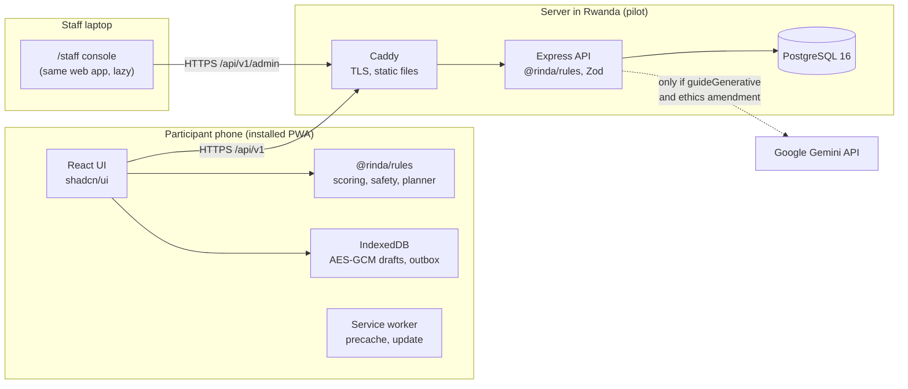
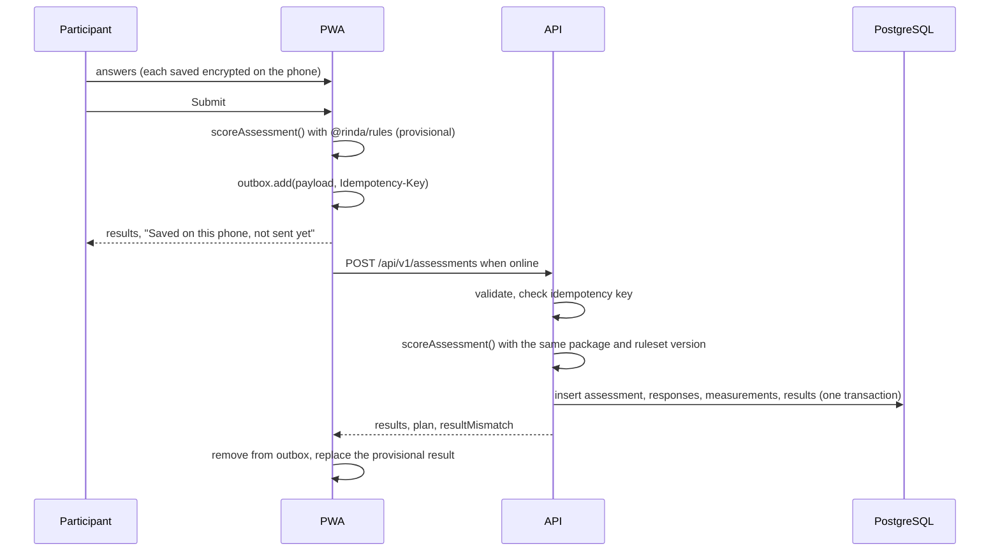

# Architecture

Three parts, one language: a React PWA, a Node.js API and PostgreSQL, sharing TypeScript packages for rules, schemas and content (SRS Sections 2.1 and 9; ADR-001 to ADR-004).

## System context



No other third parties: no analytics, no CDN, no crash reporter, no font service.

## Versions (checked 4 October 2026)

| Piece | Use | Why |
| --- | --- | --- |
| Node.js | 24 LTS (22 LTS is the SRS minimum and is supported until April 2027) | Vite 8, vite-plugin-pwa 2 and Prisma 7 need at least 20.19 |
| TypeScript | The version `create-vite` pins (6.0 today) | Version 7 is out, but wait until typescript-eslint and the Vite tooling support it |
| React | 19 | |
| Vite | 8 | |
| Tailwind CSS | 4 | Required by current shadcn/ui |
| shadcn/ui | latest CLI, **Radix** base (`-b radix`) | ADR-005 |
| vite-plugin-pwa | 2 (Workbox 7) | Same code as 1.x with a newer Node requirement |
| Express | 5 | Express 4 is at end of life |
| Zod | 4 | `z.strictObject`, `z.iso.datetime()` |
| Prisma ORM | **7, pinned with `^7`** | `npm i prisma` currently installs the Prisma 8 release candidate, a rewrite. Revisit after the pilot (ADR-013) |
| PostgreSQL | 16 or newer | |

## Dependency allowlist

Adding anything else needs the project owner's agreement.

| Workspace | Runtime | Development |
| --- | --- | --- |
| `apps/web` | `react`, `react-dom`, `react-router`, `@reduxjs/toolkit`, `react-redux`, `react-hook-form`, `@hookform/resolvers`, `zod`, `i18next`, `react-i18next`, `idb`, `lucide-react`, `@fontsource-variable/inter`, `qrcode` (clinic card, study-phone set-up and offline hand-over, lazy-loaded), `jsqr` (QR reading on the facilitator's Collect page where the browser has no built-in reader; lazy-loaded, runtime-cached, never precached; approved 14 October 2026), `@types/qrcode` (dev), and whatever `npx shadcn@latest add` installs | `vite`, `@vitejs/plugin-react`, `tailwindcss`, `@tailwindcss/vite`, `vite-plugin-pwa`, `workbox-window`, `workbox-precaching`, `workbox-routing`, `workbox-strategies`, `workbox-core`, `@types/node`, `typescript`, `vitest`, `jsdom`, `@testing-library/react`, `@testing-library/user-event`, `@playwright/test`, `@axe-core/playwright`, `eslint`, `typescript-eslint`, `eslint-plugin-react-hooks`, `eslint-plugin-jsx-a11y`, `eslint-plugin-i18next`, `prettier`, `prettier-plugin-tailwindcss` |
| `apps/api` | `express`, `helmet`, `cookie-parser`, `express-rate-limit`, `pino`, `pino-http`, `argon2`, `zod`, `@prisma/client@^7`, `@prisma/adapter-pg@^7`, `pg`, `dotenv`, `otplib` (staff TOTP) | `prisma@^7`, `@types/pg`, `@types/express`, `@types/cookie-parser`, `tsx`, `typescript`, `vitest`, `supertest`, `@types/supertest` |
| `packages/*` | `zod` only (rules has no runtime dependencies) | `typescript`, `vitest` |
| root | | `concurrently`, `tsx`, `vitest`, `@vitest/coverage-v8`, `eslint`, `@eslint/js`, `typescript-eslint`, `globals`, `eslint-plugin-react-hooks`, `eslint-plugin-jsx-a11y`, `eslint-plugin-i18next`, `prettier`, `prettier-plugin-tailwindcss`, `@playwright/test`, `@axe-core/playwright`, `typescript` |

Added in Milestone 0 (5 October 2026), pending your agreement: root dev tooling moved up from `apps/web` so every workspace shares one ESLint, Prettier, Vitest and Playwright setup; `@vitest/coverage-v8` for the 100% branch gate; `@eslint/js` and `globals` (ESLint flat config). The shadcn CLI also installed `cn`, `radix-ui`, `class-variance-authority`, `tw-animate-css`, `shadcn`, `next-themes` (Sonner), `recharts`, `sonner`, `vaul` and `input-otp`. `pino-http` is not used: a small request logger logs the route template only.

## Web app

```
apps/web/src/
  main.tsx, app/            router, providers (Redux, i18n, theme), AppShell
  components/ui/            shadcn-generated (variants and sizes only)
  components/               BandBadge, GetHelp, QuickExit, OfflineBadge, ListenButton, ...
  features/
    auth/ consent/ eligibility/ profile/ assessment/ measure/ results/ dashboard/
    what-if/ guide/ care/ safety/ privacy/ sync/ prepare/ history/ feedback/ baseline-info/
    staff/ sessions/ participants/ content/ insights/ exports/ deletions/ audit/ flags/
  lib/
    api/        RTK Query endpoints generated from @rinda/schemas types
    storage/    idb database, AES-GCM helpers, wipe()
    sync/       outbox, retry triggers, state machine
    i18n/       i18next setup, content loader
    flags/      flag fetch and cache
  sw/sw.ts                  service worker (injectManifest)
  locales/en, locales/rw    interface strings
```

- **Routing.** React Router. Participant routes are eager and small; `/staff/*`, charts, the guide and the clinic card load on demand and are excluded from the precache (ADR-009, NFR-17).
- **State.** Redux Toolkit slices for session, assessment-in-progress, sync and settings; RTK Query for server data. Persisting anything personal goes through `lib/storage` (encrypted), never Redux persistence to `localStorage` (ADR-010).
- **Rules on the client.** `@rinda/rules` is bundled into the app so scoring, item 9, the planner, explanations and What-if work offline.
- **Content.** The manifest and content bodies are fetched once per version, cached by the service worker and validated with the content schemas before use.
- **Offline and sync.** See [OFFLINE.md](OFFLINE.md).

## API

```
apps/api/src/
  server.ts, app.ts         Express 5 app factory (testable without listening)
  middleware/               requestId, security headers, rateLimit, auth (participant, staff), requireRole,
                            validate(schema), idempotency, errorHandler
  routes/                   one router per resource; /api/v1 and /api/v1/admin
  services/                 assessments (re-score), content (manifest, publish rules), consents, safety,
                            exports, deletion, insights, flags, audit
  guide/                    composer adapter, explainer (Gemini), validator, prompt
  jobs/                     deletion executor, retention purge (run daily by the host scheduler)
  lib/                      prisma client, logger (pino with redaction), crypto (Argon2id), config (Zod-validated env)
prisma/                     schema.prisma, migrations/, seed.ts (synthetic only)
prisma7.config.ts
```

**Middleware order:** request ID, Helmet (CSP and HSTS from [SECURITY_PRIVACY.md](SECURITY_PRIVACY.md)), JSON body limit (100 kb), pino-http without bodies, rate limit, authentication, role check, Zod validation, idempotency, handler, error handler (stable codes, no echoed values).

**Configuration.** Every environment variable is parsed by a Zod schema at start-up; the process exits with a clear message if one is missing. `APP_ENV` is `development`, `staging` or `pilot`. See `.env.example`.

## Submitting an assessment



## Environments and deployment

| Environment | Where | Data |
| --- | --- | --- |
| development | Laptop: `npm run dev`; Neon development branch, or Docker Compose Postgres, or no database (in-memory flags) | Synthetic seed |
| staging | Any host, Neon staging branch | Synthetic only |
| pilot | Neon production branch (supervisor-approved, ADR-014) | Real, after ethics approval |

Pilot deployment: Caddy (automatic HTTPS, serves the built web app, proxies `/api` to the API so everything is same-origin) and the API image (`apps/api/Dockerfile`), with the database on Neon (ADR-014). `docker-compose.yml` runs a local PostgreSQL and the API for development. Daily encrypted database backups with 30-day expiry; one restore drill before the pilot (NFR-07).

## Prisma setup (version 7)

```bash
cd apps/api
npm i -D prisma@^7 @types/pg
npm i @prisma/client@^7 @prisma/adapter-pg@^7 pg dotenv
```

Prisma 7 is ESM only (`"type": "module"` in `apps/api/package.json`), needs a driver adapter, reads the database URL from the config file, does not load `.env` by itself, and no longer runs `generate` or the seed after `migrate`.

```prisma
// prisma/schema.prisma
generator client {
  provider = "prisma-client"
  output   = "../src/generated/prisma"
}

datasource db {
  provider = "postgresql"
}
```

```ts
// prisma7.config.ts (Prisma 7.10 and later look for this name first, then prisma.config.ts)
import 'dotenv/config';
import { defineConfig } from 'prisma/config';

export default defineConfig({
  schema: 'prisma/schema.prisma',
  migrations: { path: 'prisma/migrations' },
  datasource: { url: process.env['DATABASE_URL'] },
});
```

```ts
// src/lib/prisma.ts
import 'dotenv/config';
import { PrismaPg } from '@prisma/adapter-pg';
import { PrismaClient } from '../generated/prisma/client';

export const prisma = new PrismaClient({
  adapter: new PrismaPg({ connectionString: process.env.DATABASE_URL }),
});
```

Then `npx prisma migrate dev --name init` and `npx prisma generate`. Add `src/generated/` to `.gitignore`. The models are in [DATA_MODEL.md](DATA_MODEL.md).

## Budgets

| Budget | Limit | Source |
| --- | --- | --- |
| Initial download, compressed | under 1 MB | NFR-06 |
| Initial JavaScript, compressed | 250 KB or less | NFR-17 |
| Cached screen load | under 1 s | NFR-06 |
| Online result | under 5 s | NFR-06 |
| Prepared offline download (both languages, no audio) | about 3 MB or less | FR-28 |
