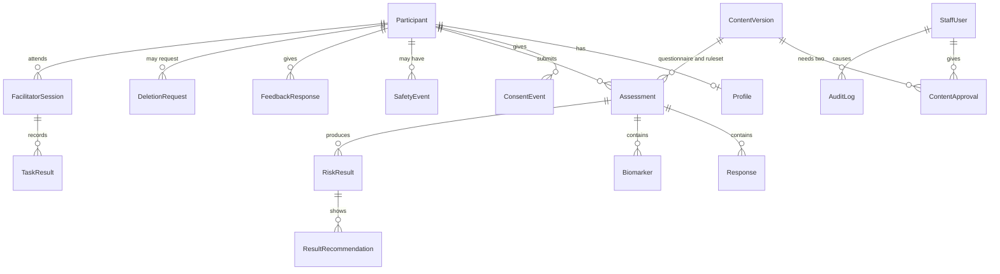

# Data model

PostgreSQL 16 through Prisma ORM and Prisma Migrate (SRS Sections 3.3 and 7.1). This file extends the SRS data model with the tables the standout features need. The Prisma schema below is a starting draft for `apps/api/prisma/schema.prisma`; refine names and types during Milestone 0, then keep this file in step.

## Overview



## Design notes

- **One content table.** The SRS lists QuestionnaireVersion, RulesetVersion, RecommendationVersion, ReferralListVersion and ConsentDocVersion. They share the same attributes, so they are one `ContentVersion` table with a `type` column. Each body is validated against its own Zod schema in `@rinda/content` before it is saved.
- **Immutability.** Published content, submitted assessments, consent events, safety events and audit entries are never updated. Corrections are new rows.
- **Drafts stay on the phone.** The server only stores submitted assessments.
- **Two IDs for a participant.** `studyCode` is what the participant types; `researchId` is a separate random ID used in exports, so exported data cannot be matched to the code on a consent sheet.
- **Append-only audit log.** The runtime database role gets `INSERT` and `SELECT` only on `audit_log` (set in a migration); no API route updates or deletes it (FR-48).
- **Deletion** (FR-18). Removes profile, assessments and children, feedback, task results, refresh tokens and usability events. Keeps a participant stub (`id`, `studyCode`, `withdrawnAt`, `deletedAt`) plus consent and safety events for the period the ethics approval sets, then purges them.
- **Check constraints** added in SQL migrations: a `Response` has exactly one of `valueNumber`, `valueCode` or `missingness`; `Biomarker.value` falls inside the validation ranges; `SafetyEvent.tier` is 1 to 3.

## Draft Prisma schema

```prisma
// generator and datasource blocks: see "Prisma setup" at the end of this file

enum Sex { female male not_stated }
enum OrderAssignment { AB BA }
enum ConsentScope { core mental_wellness audio follow_up ai_explanations }
enum ContentType { questionnaire ruleset recommendation referral_list consent_doc feedback_form guide_chips audio_manifest }
enum ContentStatus { draft in_review published retired }
enum ApprovalDecision { approved changes_requested }
enum StaffRole { researcher_admin facilitator reviewer }
enum ReviewerType { supervisor clinical mental_health language community }
enum Missingness { SKIPPED MODULE_DECLINED DONT_KNOW NOT_APPLICABLE }
enum Domain { tobacco alcohol activity diet bmi waist bp phq9 gad7 }
enum MeasurementType { height weight waist systolic diastolic }
enum MeasurementSource { in_session recalled }
enum SafetyTrigger { item9 score_threshold observed disclosed }
enum DeletionStatus { requested completed }
enum TaskOutcome { completed completed_with_help not_completed }

model Participant {
  id              String          @id @default(uuid()) @db.Uuid
  studyCode       String          @unique
  researchId      String          @unique @default(uuid()) @db.Uuid
  pinHash         String?
  orderAssignment OrderAssignment
  failedAttempts  Int             @default(0)
  lockedUntil     DateTime?
  createdAt       DateTime        @default(now())
  withdrawnAt     DateTime?
  deletedAt       DateTime?
  profile         Profile?
  consents        ConsentEvent[]
  assessments     Assessment[]
  safetyEvents    SafetyEvent[]
  feedback        FeedbackResponse[]
  deletionRequests DeletionRequest[]
  sessions        FacilitatorSession[]
  refreshTokens   RefreshToken[]
}

model Profile {
  participantId     String      @id @db.Uuid
  participant       Participant @relation(fields: [participantId], references: [id], onDelete: Cascade)
  ageBand           String      // "18-24" | "25-29" | "30-35"
  sex               Sex
  districtBand      String
  educationBand     String?
  deviceType        String?
  preferredLanguage String      // "en" | "rw"
  updatedAt         DateTime    @updatedAt
}

model ConsentEvent {
  id                  String       @id @default(uuid()) @db.Uuid
  participantId       String       @db.Uuid
  participant         Participant  @relation(fields: [participantId], references: [id])
  scope               ConsentScope
  granted             Boolean
  consentDocVersionId String       @db.Uuid
  language            String
  createdAt           DateTime     @default(now())
  @@index([participantId, scope, createdAt])
}

model ContentVersion {
  id          String            @id @default(uuid()) @db.Uuid
  type        ContentType
  key         String            // "ncd-questionnaire", "ruleset", "referral-list", ...
  version     String            // "1.0.0"
  language    String?           // null when language-neutral (the ruleset)
  body        Json
  bodyHash    String            // sha-256 of canonical JSON
  status      ContentStatus     @default(draft)
  createdById String            @db.Uuid
  createdAt   DateTime          @default(now())
  publishedAt DateTime?
  approvals   ContentApproval[]
  @@unique([type, key, version, language])
}

model ContentApproval {
  id               String           @id @default(uuid()) @db.Uuid
  contentVersionId String           @db.Uuid
  contentVersion   ContentVersion   @relation(fields: [contentVersionId], references: [id])
  approverId       String           @db.Uuid
  approver         StaffUser        @relation(fields: [approverId], references: [id])
  approverRole     StaffRole
  reviewerType     ReviewerType?
  decision         ApprovalDecision
  notes            String?          // staff notes only, never participant data
  createdAt        DateTime         @default(now())
  @@unique([contentVersionId, approverId]) // one decision per person, so two approvals mean two people
}

model Assessment {
  id                     String       @id @default(uuid()) @db.Uuid
  participantId          String       @db.Uuid
  participant            Participant  @relation(fields: [participantId], references: [id], onDelete: Cascade)
  questionnaireVersionId String       @db.Uuid
  rulesetVersionId       String       @db.Uuid
  idempotencyKey         String       @db.Uuid
  requestHash            String
  language               String
  startedAt              DateTime
  submittedAt            DateTime
  receivedAt             DateTime     @default(now())
  clientResultHash       String?
  serverResultHash       String
  resultMismatch         Boolean      @default(false)
  responses              Response[]
  biomarkers             Biomarker[]
  results                RiskResult[]
  @@unique([participantId, idempotencyKey])
}

model Response {
  id           String       @id @default(uuid()) @db.Uuid
  assessmentId String       @db.Uuid
  assessment   Assessment   @relation(fields: [assessmentId], references: [id], onDelete: Cascade)
  questionCode String
  valueNumber  Decimal?     @db.Decimal(8, 2)
  valueCode    String?
  missingness  Missingness?
  @@unique([assessmentId, questionCode])
}

model Biomarker {
  id           String            @id @default(uuid()) @db.Uuid
  assessmentId String            @db.Uuid
  assessment   Assessment        @relation(fields: [assessmentId], references: [id], onDelete: Cascade)
  type         MeasurementType
  value        Decimal           @db.Decimal(6, 1)
  unit         String
  source       MeasurementSource
  measuredOn   DateTime          @db.Date
  rechecked    Boolean           @default(false)
  @@unique([assessmentId, type])
}

model RiskResult {
  id                  String     @id @default(uuid()) @db.Uuid
  assessmentId        String     @db.Uuid
  assessment          Assessment @relation(fields: [assessmentId], references: [id], onDelete: Cascade)
  domain              Domain
  bandCode            String
  severity            String     // ok | attention | confirm | urgent | wellness | unknown
  value               Decimal?   @db.Decimal(6, 1)
  completeness        String     // complete | partial | none
  contributingFactors String[]
  rulesetVersionId    String     @db.Uuid
  recommendations     ResultRecommendation[]
  @@unique([assessmentId, domain])
}

model ResultRecommendation {
  id                 String     @id @default(uuid()) @db.Uuid
  riskResultId       String     @db.Uuid
  riskResult         RiskResult @relation(fields: [riskResultId], references: [id], onDelete: Cascade)
  contentVersionId   String     @db.Uuid
  recommendationCode String
}

model SafetyEvent {
  id                   String        @id @db.Uuid  // generated on the phone; doubles as idempotency key
  participantId        String        @db.Uuid
  participant          Participant   @relation(fields: [participantId], references: [id])
  tier                 Int
  triggerType          SafetyTrigger
  actions              String[]
  occurredAt           DateTime
  recordedByRole       String        // system | facilitator
  recordedById         String?       @db.Uuid
  supervisorInformedAt DateTime?
  receivedAt           DateTime      @default(now())
}

model FeedbackResponse {
  id            String       @id @db.Uuid  // generated on the phone
  participantId String       @db.Uuid
  participant   Participant  @relation(fields: [participantId], references: [id], onDelete: Cascade)
  formVersionId String       @db.Uuid
  condition     String       // A | B | post_session
  itemCode      String
  value         Int?
  missingness   Missingness?
  createdAt     DateTime     @default(now())
}

model DeletionRequest {
  id            String         @id @default(uuid()) @db.Uuid
  participantId String         @db.Uuid
  participant   Participant    @relation(fields: [participantId], references: [id])
  status        DeletionStatus @default(requested)
  requestedAt   DateTime       @default(now())
  completedAt   DateTime?
  completedById String?        @db.Uuid
}

model StaffUser {
  id           String            @id @default(uuid()) @db.Uuid
  email        String            @unique
  passwordHash String
  role         StaffRole
  reviewerType ReviewerType?
  totpSecret   String?           // encrypted at rest with a key from the secret store
  active       Boolean           @default(true)
  createdAt    DateTime          @default(now())
  lastSignInAt DateTime?
  approvals    ContentApproval[]
  auditEntries AuditLog[]
  sessions     FacilitatorSession[]
}

model FacilitatorSession {
  id            String       @id @default(uuid()) @db.Uuid
  participantId String       @db.Uuid
  participant   Participant  @relation(fields: [participantId], references: [id], onDelete: Cascade)
  facilitatorId String       @db.Uuid
  facilitator   StaffUser    @relation(fields: [facilitatorId], references: [id])
  deviceLabel   String?      // "Study phone 2"
  startedAt     DateTime     @default(now())
  endedAt       DateTime?
  tasks         TaskResult[]
}

model TaskResult {
  id              String             @id @default(uuid()) @db.Uuid
  sessionId       String             @db.Uuid
  session         FacilitatorSession @relation(fields: [sessionId], references: [id], onDelete: Cascade)
  taskCode        String
  outcome         TaskOutcome
  durationSeconds Int
  recordedAt      DateTime           @default(now())
  @@unique([sessionId, taskCode])
}

model RefreshToken {
  id            String      @id @default(uuid()) @db.Uuid
  participantId String      @db.Uuid
  participant   Participant @relation(fields: [participantId], references: [id], onDelete: Cascade)
  tokenHash     String      @unique
  expiresAt     DateTime
  revokedAt     DateTime?
  replacedById  String?     @db.Uuid
}

model AuditLog {
  id         BigInt     @id @default(autoincrement())
  actorId    String?    @db.Uuid
  actor      StaffUser? @relation(fields: [actorId], references: [id])
  actorRole  String
  action     String     // "content.publish", "export.create", "flag.update", ...
  targetType String?
  targetId   String?
  metadata   Json?      // never participant answers or values
  createdAt  DateTime   @default(now())
}

model FeatureFlag {
  key         String
  environment String   // development | staging | pilot
  enabled     Boolean
  updatedById String?  @db.Uuid
  updatedAt   DateTime @updatedAt
  @@id([key, environment])
}

model ExportLog {
  id               String   @id @default(uuid()) @db.Uuid
  staffId          String   @db.Uuid
  dataset          String
  versionsIncluded Json
  rowCount         Int
  createdAt        DateTime @default(now())
}

model GuideRequestLog {
  id               String   @id @default(uuid()) @db.Uuid
  chipId           String
  source           String   // generated | template
  validatorOutcome String   // pass | numbers | sources | banned | scope | language | schema | error | flag_off
  model            String?
  latencyMs        Int
  inputTokens      Int?
  outputTokens     Int?
  cacheReadTokens  Int?
  helpful          Boolean?
  createdAt        DateTime @default(now())
  // deliberately no participant ID, no prompt, no answer text
}

// Only created if the approved protocol covers screen timings (flag usabilityEvents)
model UsabilityEvent {
  id            String   @id @db.Uuid
  participantId String   @db.Uuid
  screenId      String
  enteredAt     DateTime
  leftAt        DateTime?
}
```

## Prisma setup

The generator and datasource blocks depend on the Prisma major version installed in Milestone 0. Follow [ARCHITECTURE.md](ARCHITECTURE.md), section "Prisma setup".
